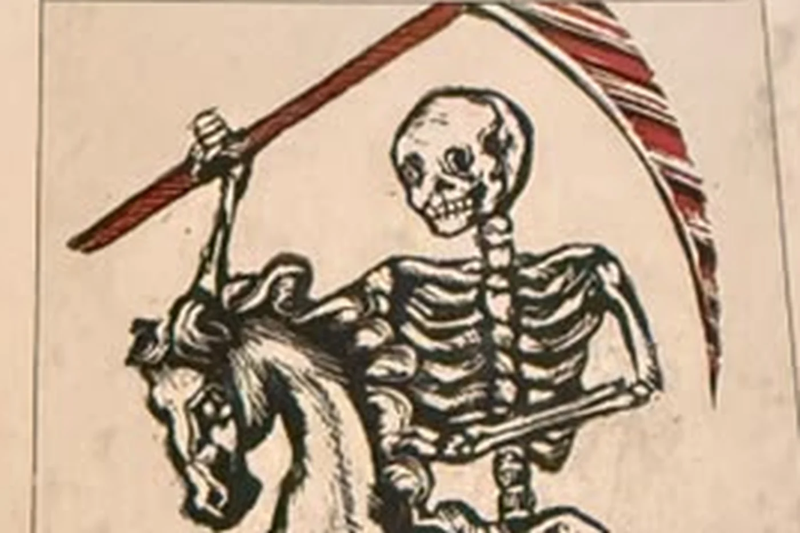
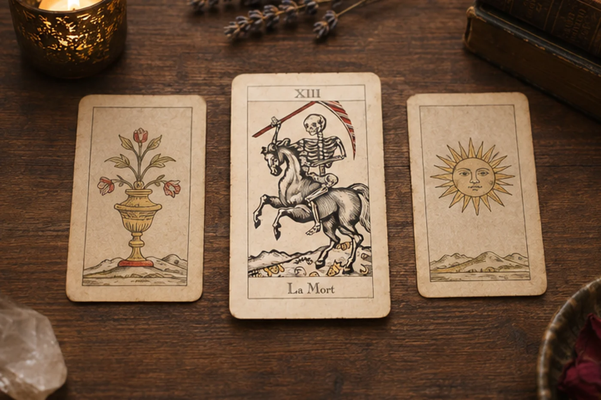
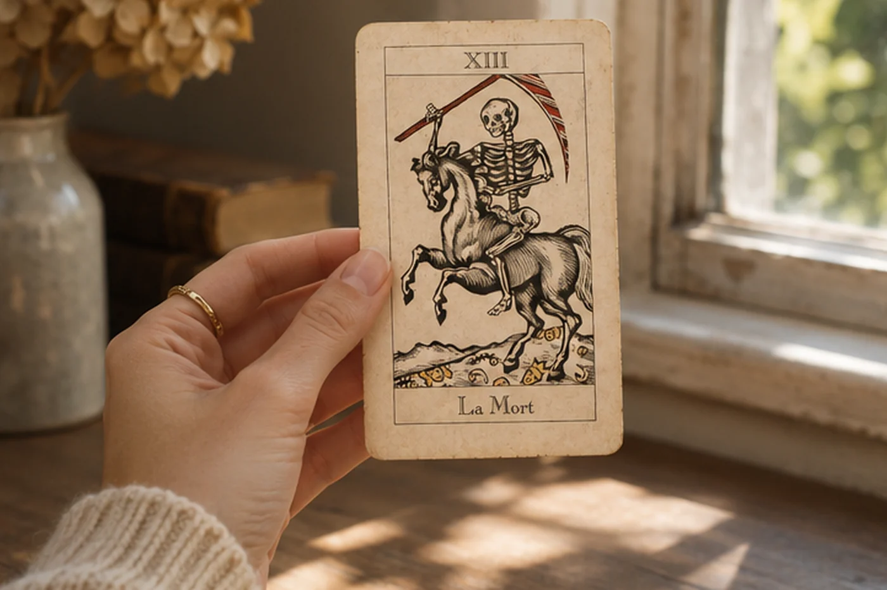

Non, tirer la carte 13 n'annonce pas un décès. Dans le Tarot de Marseille, cette lame parle de **ce qui se termine pour que la suite puisse exister** : une période, un fonctionnement, un lien qui a fait son temps. Elle est brutale dans son image et rarement dans son message.

Et elle a une particularité que peu de gens remarquent : **c'est la seule lame du jeu qui ne porte pas de nom.** Les vingt-et-une autres sont titrées en toutes lettres au bas de la carte. Celle-ci, dans les Tarots de Marseille classiques, laisse la bande inférieure vide. On l'appelle d'ailleurs souvent « l'arcane sans nom ».

Cette absence n'est pas un oubli d'imprimeur, et c'est par là qu'il faut commencer.

## La lame qu'on ne nomme pas

Ne pas nommer une chose, c'est refuser de la figer. Les anciens cartiers ont titré La Papesse, L'Amoureux, La Roue de Fortune, La Maison Dieu — y compris les lames inquiétantes. Mais pas celle-ci.

L'interprétation la plus répandue est aussi la plus simple : on ne nomme pas ce qu'on ne connaît pas. Ce qui se trouve après une fin échappe à la description. Le dessin montre donc l'opération, pas sa conclusion.

Que vous adhériez ou non à cette lecture symbolique, elle a une conséquence très concrète sur un tirage : **cette carte ne se lit jamais seule.** Les autres lames disent ce qu'elle nomme, et c'est précisément ce que j'explique dans mes séances d'initiation.

<figure class="article-illustration">
  
</figure>

## Ce que montre l'image, détail par détail

Regardez la carte plutôt que son nom supposé. Trois éléments comptent.

**La faux travaille au ras du sol.** Elle ne frappe pas de haut ; elle coupe à la base, comme on fauche un champ. On ne fauche pas pour détruire, on fauche pour récolter et pour que ça repousse. C'est un geste agricole, saisonnier, pas un geste de guerre.

**Le sol n'est pas vide.** Des éléments y dépassent encore — ce qui reste après le passage. La lame ne montre jamais une terre nette. Il y a un avant et un après, et l'après contient des restes du précédent.

**Le squelette est en mouvement.** Il avance. L'image n'est pas celle d'un gisant mais d'une marche, ce qui a son importance : la lame décrit un processus en cours, pas un état atteint.

Trois détails, trois indications qui disent la même chose — **un passage, pas un point final**.

## Ce qu'elle annonce en tirage

Dans ma pratique, la 13 sort quand quelque chose est déjà fini sans qu'on se le soit encore avoué. Un poste qu'on n'habite plus depuis des mois. Une relation maintenue par habitude. Une façon de fonctionner qui a protégé pendant des années et qui aujourd'hui enferme.

Elle est rarement une annonce : le plus souvent, c'est un constat. Et c'est ce qui la rend utile. Les personnes qui la tirent savent déjà, confusément, ce qu'elle désigne — la carte ne fait que donner une forme à quelque chose qu'on repoussait.

Elle invite aussi à ne pas s'accrocher. C'est inconfortable, et c'est le seul vrai inconfort de cette lame : elle ne propose pas de négocier.

<figure class="article-illustration">
  
</figure>

## Sa position change tout

Une même carte ne dit pas la même chose selon l'endroit où elle tombe. C'est vrai pour les vingt-deux arcanes, et particulièrement visible pour celle-ci.

En **position de passé**, elle décrit une rupture déjà vécue : vous avez traversé quelque chose, et la lecture va surtout chercher ce que vous en avez gardé.

En **position de présent**, elle indique que le mouvement est en cours, même si vous le freinez. La question devient : qu'est-ce que je retarde, et pourquoi ?

En **position d'obstacle**, elle est presque toujours un refus de lâcher. L'obstacle n'est pas l'événement, c'est l'attachement à ce qui n'existe plus.

En **position de conseil**, enfin, elle recommande de couper. Franchement, et sans attendre que les circonstances décident à votre place.

Pour comprendre comment ces positions s'organisent, la [présentation des principaux tirages](/blog/les-principaux-tirages-de-tarot-lequel-choisir-selon-votre-question/) vous donnera la logique d'ensemble.

## Les cartes qui l'accompagnent

La 13 entourée de L'Étoile, du Soleil ou du Monde raconte une fin qui ouvre. Entourée de La Lune, du Pendu ou du Huit d'Épée, elle raconte une fin qu'on subit plutôt qu'on ne choisit — ce n'est pas le même accompagnement, ni les mêmes mots pendant la séance.

C'est là que se joue la différence entre lire une carte et lire un tirage. Mémoriser vingt-deux significations prend quelques semaines. Apprendre à les faire dialoguer prend beaucoup plus longtemps, et c'est tout l'intérêt de la chose.

<figure class="article-illustration">
  
</figure>

## « Je l'ai tirée, qu'est-ce que je fais ? »

Rien d'urgent. Notez la date, notez la question que vous aviez posée, et regardez les deux ou trois cartes voisines : ce sont elles qui portent le sens. Puis laissez passer quelques jours avant de décider quoi que ce soit — une lame de fin n'appelle pas une décision immédiate, elle appelle une lucidité.

Et si vous préférez ne pas rester seul·e avec ça, c'est exactement ce à quoi sert une [consultation](/#services) : mettre des mots sur ce que vous avez déjà compris.

## Apprendre à la lire vous-même

Si cet article vous a donné envie d'aller plus loin, c'est bon signe : la treizième lame est une excellente porte d'entrée dans le Tarot de Marseille, parce qu'elle oblige d'emblée à sortir de la signification apprise par cœur.

Je propose des **séances d'initiation à la tarologie**, en leçon particulière d'une heure, en visio ou à domicile entre Nice et Saint-Laurent-du-Var : découverte des arcanes majeurs, symbolisme, numérologie, apprentissage des tirages et lecture croisée entre les lames. Il existe aussi une **journée de formation en groupe**, à partir de quatre personnes.

Tout est détaillé sur la [page formation](/formation-tarot/) — contenu, formats et modalités. Et si vous hésitez encore sur l'engagement que cela représente, l'article sur [le temps nécessaire pour apprendre à lire le Tarot](/blog/combien-de-temps-apprendre-tarot-marseille/) répond à la question avant que vous ne la posiez.
