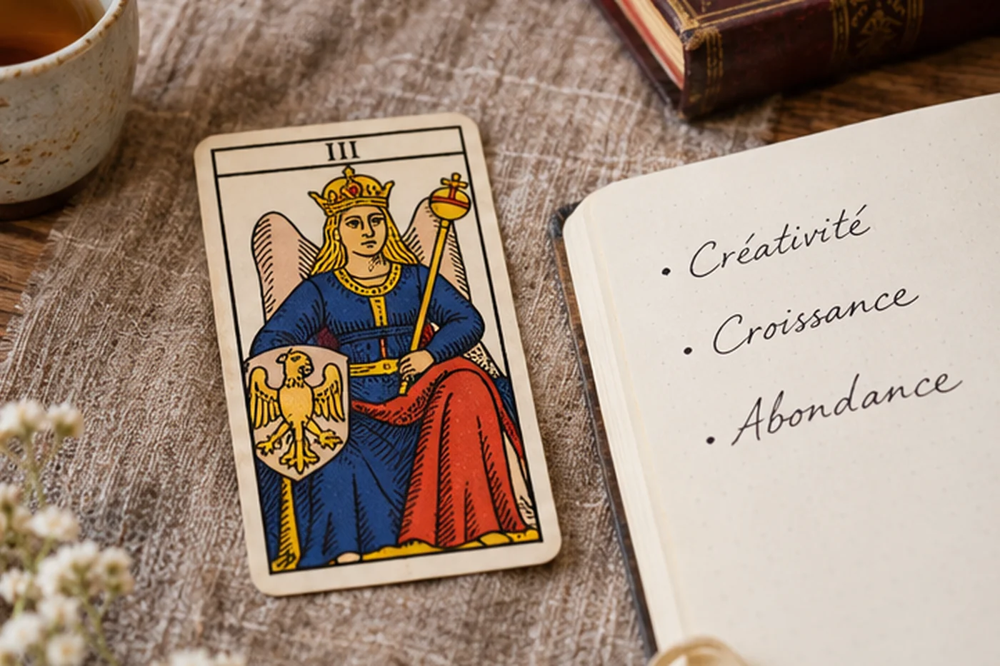
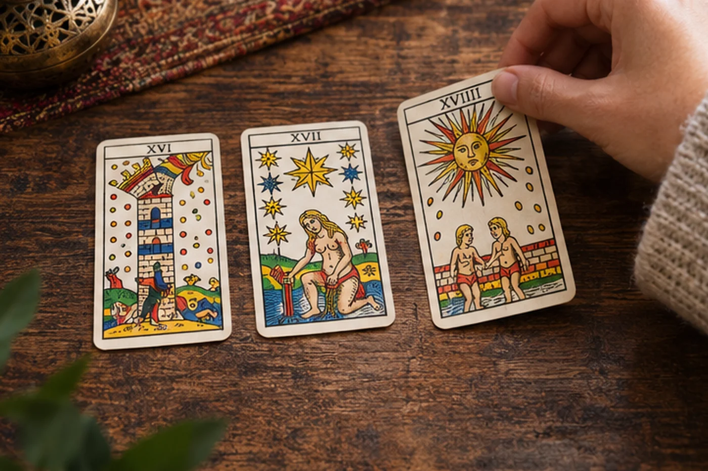
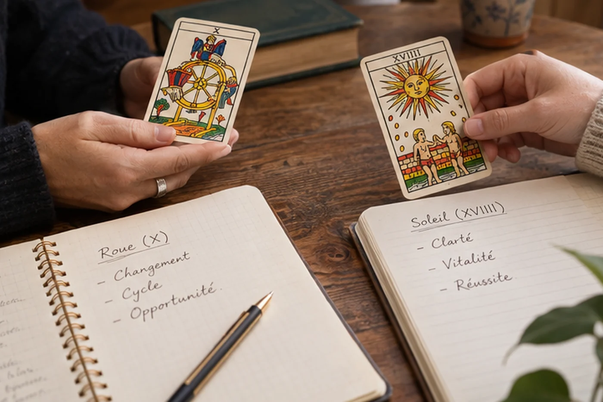

Comptez **quelques semaines pour connaître les vingt-deux arcanes majeurs** à raison d'une carte par jour ou deux, et **plusieurs mois pour commencer à lire un tirage** — c'est-à-dire pour faire parler les cartes entre elles plutôt que l'une après l'autre. Les premiers tirages honnêtes arrivent vers le troisième ou quatrième mois chez la plupart des personnes que j'accompagne.

Autrement dit : la partie qu'on redoute, la mémorisation, est la plus rapide. La partie qu'on n'imagine pas, la lecture croisée, est celle qui demande du temps. Voici comment ça se répartit réellement.

## Ce que vous apprenez en une séance

Une heure suffit largement à poser les fondations, et c'est souvent une surprise.

Vous repartez avec la structure du jeu — pourquoi vingt-deux arcanes et pas vingt ou trente, ce que raconte leur ordre. Avec la logique des nombres, qui vous évite d'apprendre vingt-deux significations indépendantes : un III et un XII ont des parentés, et les voir divise par deux l'effort de mémoire. Avec la façon de regarder une image : les couleurs, la direction du regard, ce que le personnage tient et ce qu'il tourne le dos.

Et avec votre premier tirage à trois cartes, fait pour vous, sur une vraie question.

C'est ce que couvre une séance d'initiation, et c'est volontairement dense : l'objectif n'est pas que vous reteniez tout, mais que vous sachiez quoi regarder quand vous rouvrez le jeu seul·e le lendemain.

<figure class="article-illustration">
  
</figure>

## Les semaines suivantes : la mémoire

Vingt-deux cartes, c'est moins qu'une liste de courses hebdomadaire. La méthode qui marche le mieux tient en une phrase : **une carte par jour, tirée au hasard, cinq minutes le matin.**

Vous la regardez, vous notez trois mots dans un carnet, vous refermez. Le soir, vous relisez vos trois mots et vous regardez si la journée leur a donné un écho. Au bout de trois semaines, vous aurez croisé chaque arcane une fois, et surtout vous aurez des souvenirs attachés aux cartes — ce qui vaut infiniment mieux qu'une définition recopiée.

Ne cherchez pas à apprendre les significations « à l'endroit » et « à l'envers » en même temps. C'est le meilleur moyen de tout confondre. Les sens inversés viennent plus tard, quand le sens droit est solide.

## Ce qui prend des mois : lire entre les cartes

Voilà le vrai apprentissage, et personne ne le dit assez clairement.

Une carte seule ne veut presque rien dire. La treizième lame dans un tirage lumineux n'a pas le même message que la même lame entourée de cartes difficiles — j'en parle en détail dans [l'article consacré à la carte 13](/blog/arcane-13-tarot-marseille-signification/). C'est le voisinage qui donne le sens, comme un mot prend son sens dans sa phrase.

Apprendre cela demande du temps parce que ça ne s'apprend pas : ça se pratique. Il faut poser beaucoup de tirages, se tromper, revenir dessus quelques semaines plus tard et constater ce qu'on n'avait pas vu. C'est pour cette raison que je conseille de **dater et de garder ses tirages**. Un carnet relu trois mois après vous apprendra davantage que n'importe quel manuel.

## Peut-on apprendre seul, avec un livre ?

Honnêtement : en partie, oui. La mémorisation des arcanes se fait très bien seul·e, et il existe d'excellents ouvrages.

Deux choses s'apprennent mal en autodidacte, et il vaut mieux le savoir avant de s'entêter.

**La formulation de la question.** C'est l'erreur la plus répandue et la plus invisible : on apprend à lire des cartes sans jamais apprendre à poser la question qui rend le tirage lisible. Un tirage sur une mauvaise question donne une lecture confuse qu'on met ensuite sur le compte de son manque de niveau. [La façon de poser une question](/blog/comment-poser-une-bonne-question-au-tarot/) se corrige en une séance et change tout.

**Le retour extérieur.** Seul·e, vous validez vos propres interprétations. Avec quelqu'un qui pratique, vous entendez ce que vous aviez écarté sans vous en rendre compte — et c'est souvent là que se trouve l'essentiel du tirage.

<figure class="article-illustration">
  
</figure>

## Les trois erreurs qui font perdre un an

**Vouloir tout apprendre d'un coup.** Arcanes majeurs, arcanes mineurs, sens inversés, numérologie et correspondances astrologiques en même temps. Prenez les vingt-deux majeurs, uniquement, pendant trois mois. Le reste attendra et s'installera dix fois mieux.

**Changer de jeu tous les deux mois.** Chaque jeu a ses codes graphiques. En changer sans cesse empêche les images de s'imprimer. Gardez le même pendant au moins un an.

**Ne tirer que pour soi, et seulement quand ça ne va pas.** Vous ne verrez alors que ce que vous craignez. Tirez aussi des jours ordinaires, sur des questions sans enjeu — c'est là qu'on apprend à distinguer une lecture d'une projection.

## Par où commencer cette semaine, sans rien dépenser

Prenez n'importe quel jeu de Tarot de Marseille, même d'occasion. Sortez les vingt-deux arcanes majeurs et rangez le reste : vous n'en aurez pas besoin avant longtemps.

Ouvrez un carnet. Tirez une carte le matin, notez trois mots, relisez le soir. Pendant trois semaines, ne faites rien d'autre.

À la fin de ces trois semaines, vous saurez si le sujet vous tient vraiment — et vous aurez déjà de quoi poser des questions précises, ce qui rend la suite beaucoup plus rapide.

<figure class="article-illustration">
  
</figure>

## Se faire accompagner

Si vous préférez ne pas démarrer seul·e, je propose des **séances d'initiation d'une heure**, en leçon particulière, en visio ou à domicile entre Nice et Saint-Laurent-du-Var. Le contenu s'adapte à votre niveau : découverte des arcanes, symbolisme et numérologie, apprentissage des différents tirages, puis lecture croisée entre les lames.

Il existe également une **journée de formation en groupe**, à partir de quatre personnes, pour celles et ceux qui préfèrent apprendre à plusieurs.

Le détail des formats se trouve sur la [page formation](/formation-tarot/). Et si vous souhaitez d'abord voir à quoi ressemble une lecture complète avant de vous lancer dans l'apprentissage, la [lecture écrite d'un tirage](/lecture-de-tirage/) est un bon point de départ.
