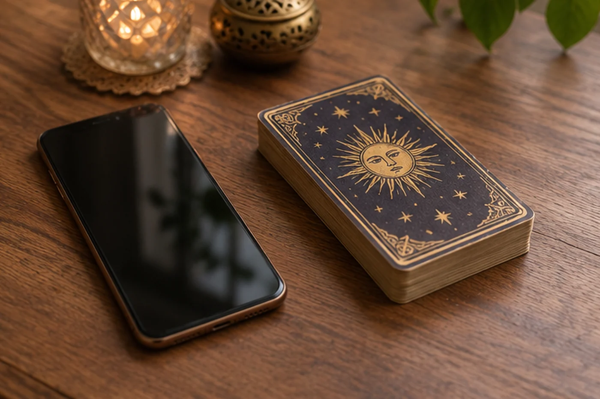
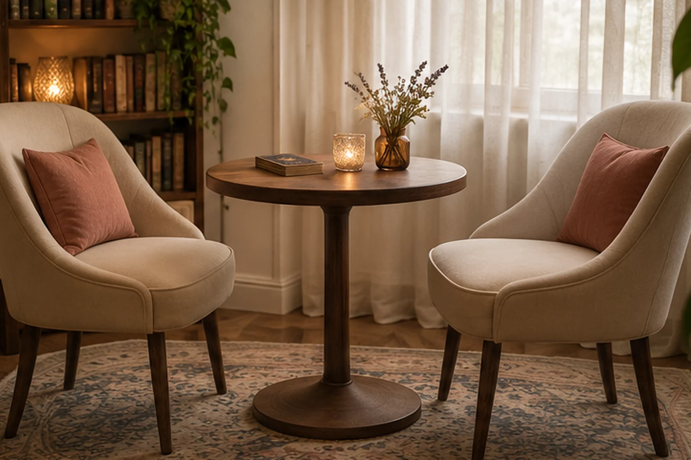

Une consultation de voyance sérieuse se situe le plus souvent **entre 40 et 150 €**, selon sa durée et son mode. En dessous, il s'agit généralement d'un format très court ou d'un appel facturé à la minute. Au-dessus, on paie une notoriété, un cadre particulier ou un déplacement lointain — rarement une meilleure lecture.

C'est la réponse courte. Le reste de cet article explique **ce qui compose réellement ce prix**, pourquoi deux praticien·nes peuvent afficher du simple au triple pour un temps équivalent, et à quoi reconnaître une facturation qui va vous échapper.

## Ce qui fait varier le prix d'une consultation

Trois éléments pèsent, et ils sont tous mesurables.

**La durée**, d'abord. C'est le facteur dominant. Une consultation de trente minutes et une consultation de deux heures ne demandent ni la même préparation, ni la même énergie, ni le même nombre de cartes posées. Quand un tarif vous est annoncé, demandez toujours à quelle durée il correspond : un prix sans durée ne veut rien dire.

**Le mode**, ensuite. Téléphone, visio ou domicile ne coûtent pas la même chose, et l'écart n'est pas une marge : une consultation à domicile mobilise le trajet aller, le trajet retour et l'installation. Compter dix à quinze euros de plus pour un déplacement local est normal ; au-delà, c'est que la zone desservie est trop large pour être tenue correctement.

**Le format de la lecture**, enfin. Un tirage ciblé sur une question précise n'occupe pas le même temps qu'un bilan complet de chemin de vie. Et une lecture écrite, rédigée après coup, demande des heures de travail que vous ne voyez pas — ce qui explique qu'elle soit parfois plus chère qu'un échange oral de même durée.

<figure class="article-illustration">
  
</figure>

## Pourquoi le téléphone coûte moins cher que le domicile

La question revient souvent, et la réponse n'a rien de mystérieux. À domicile, je me déplace, je m'installe, je range : une consultation d'une heure occupe en réalité deux heures de ma journée. Par téléphone, l'heure annoncée est l'heure travaillée.

Cela ne veut pas dire qu'une consultation téléphonique vaut moins. Beaucoup de personnes se livrent plus facilement sans être regardées, et la lecture n'en est pas affectée : les cartes se posent de la même façon, je les décris au fur et à mesure. Le choix se fait sur votre confort, pas sur la qualité.

Si vous hésitez entre les deux, l'article sur [le déroulement d'une consultation](/blog/deroulement-consultation/) détaille ce qui se passe concrètement dans chaque cas.

## Les trois pratiques qui font exploser la note

Voici les mécanismes qui transforment une consultation annoncée à vingt euros en facture à trois chiffres. Ils sont parfaitement légaux, ce qui les rend d'autant plus faciles à subir.

**La facturation à la minute.** Un tarif affiché « à partir de 0,80 € la minute » paraît dérisoire. Une consultation d'une heure revient pourtant à 48 €, et la minute court pendant les silences, les hésitations et les relances. Surtout, la personne au bout du fil n'a aucun intérêt à être brève. Une consultation au forfait vous protège de ce conflit d'intérêts : le temps est annoncé à l'avance, il ne dépend pas du rythme de la conversation.

**Les rappels et les relances.** Après un premier appel, certaines plateformes rappellent pour « une information importante reçue depuis ». C'est un argument commercial, pas une pratique divinatoire. Une lecture se termine quand elle se termine ; personne ne reçoit spontanément des compléments la semaine suivante.

**Les « travaux » payants.** C'est le plus grave. Quand une consultation débouche sur la proposition d'un rituel, d'une désenvoûtement, d'une bougie ou d'une intervention facturée en plus pour « lever un blocage », vous n'êtes plus dans la voyance : vous êtes face à une mécanique d'escalade bien connue, qui s'appuie sur l'inquiétude que la consultation vient précisément de créer. Je ne propose rien de tel, et aucune praticienne sérieuse ne le fait.

<figure class="article-illustration">
  
</figure>

## Ce qu'un tarif honnête comprend — et ce qu'il ne promet pas

Un prix clair annonce **une durée, un mode et un périmètre**. Il inclut le temps d'échange avant le tirage, le tirage lui-même, l'interprétation, et vos questions. Il ne comporte pas de supplément surprise à la fin.

Ce qu'un tarif ne peut pas garantir, en revanche, c'est un résultat. Personne ne peut vous vendre une certitude sur une décision qui ne vous appartient pas, ni sur les sentiments d'une autre personne, ni sur une date. Une consultation vous aide à voir plus clair dans ce qui vous revient, à nommer ce qui bloque, à examiner les possibilités que vous n'aviez pas posées à plat. C'est déjà beaucoup, et c'est ce qui est facturé.

Je ne réponds pas non plus aux questions de santé, qui relèvent d'un médecin, ni aux questions juridiques, qui relèvent d'un avocat. Un tarif honnête, c'est aussi un périmètre annoncé.

## Mes tarifs

Les voici, sans qu'il soit nécessaire de me contacter pour les obtenir.

**Par téléphone**, depuis toute la France : le Tirage Flash à **40 €** pour trente minutes sur une question précise, la Voyance Générale à **70 €** pour une heure, la Voyance Approfondie à **95 €** pour une heure trente, et la Guidance Complète à **135 €** pour deux heures.

**À domicile**, sur Nice et ses environs : la Voyance Générale à **80 €**, l'Approfondie à **105 €**, la Guidance Complète à **145 €**. L'écart avec le téléphone correspond au déplacement, qui est inclus.

Il existe aussi une **lecture écrite** de votre tirage, rédigée par mes soins et envoyée par écrit, à **10 €** en ce moment au lieu de 29 € — c'est la façon la plus accessible de commencer, et vous gardez le texte. Elle passe par [Auréa](/aurea/), mon application de tirage.

Enfin, si vous souhaitez apprendre à lire les cartes plutôt que de me consulter, les séances d'initiation à la tarologie et la journée de formation en groupe sont présentées sur la [page formation](/formation-tarot/).

<figure class="article-illustration">
  
</figure>

## Comment choisir sans se tromper

Si c'est votre première fois, prenez le format le plus court. Le Tirage Flash ou la lecture écrite suffisent largement à savoir si ma façon de travailler vous parle. Vous pourrez toujours prendre une heure complète ensuite ; l'inverse est plus frustrant.

Si vous avez plusieurs sujets en tête, prenez au contraire du temps : une heure trente passe très vite quand on aborde à la fois le travail, une relation et une décision à venir. Et pour tirer le meilleur de la séance, quelle que soit sa durée, [la façon dont vous formulez votre question](/blog/comment-poser-une-bonne-question-au-tarot/) compte davantage que le nombre de minutes achetées.

Pour réserver un créneau ou simplement me poser une question avant de vous décider, tout se passe sur la [page de contact](/#contact).
